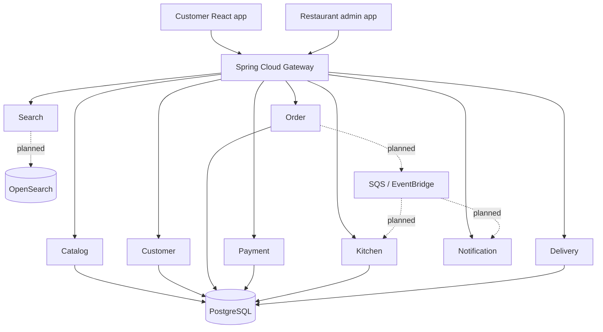

# Architecture

## Business capabilities

- Catalog: menu items, categories, prices and availability.
- Customer: profiles and delivery addresses.
- Order: order creation, items and state transitions.
- Payment: payment attempts and payment status.
- Kitchen: order acceptance and preparation statuses.
- Delivery: driver assignment and delivery status.
- Search: menu discovery.
- Notification: customer and staff updates.
- API Gateway: external request routing.

## Logical system view



Dotted lines are target integrations, not completed runtime paths in the current source.

## Order lifecycle

```text
CREATED
  -> PAYMENT_PENDING (online payment)
  -> CONFIRMED
  -> ACCEPTED
  -> PREPARING
  -> READY
  -> OUT_FOR_DELIVERY
  -> DELIVERED
```

Alternative terminal states include `PAYMENT_FAILED` and `CANCELLED`. The order service should enforce legal transitions and reject invalid state changes.

## Data ownership

Each service should own its persistence model and write operations. For the learning/development environment, services may share one PostgreSQL instance, but avoid direct cross-service table writes. Prefer APIs or versioned events for integration. Use separate database users/schemas as the implementation matures.

OpenSearch is a derived search index, not the source of truth for menu prices or transactional orders. Rebuild it from catalog data/events when necessary.

## Messaging target

Use an outbox record written in the same database transaction as the business update. A publisher forwards the event to SQS/EventBridge. Consumers must be idempotent and handle retries and dead-letter queues.

## Security boundaries

- Customer and staff identities should be authenticated using Cognito/OIDC or another approved identity provider.
- The gateway and services must enforce role/ownership authorization.
- Service workloads should use least-privilege AWS identities.
- Validate all prices, availability, promotions and payment webhooks server-side.
- Do not allow a public API to mutate payment or order state without authorization and validation.
