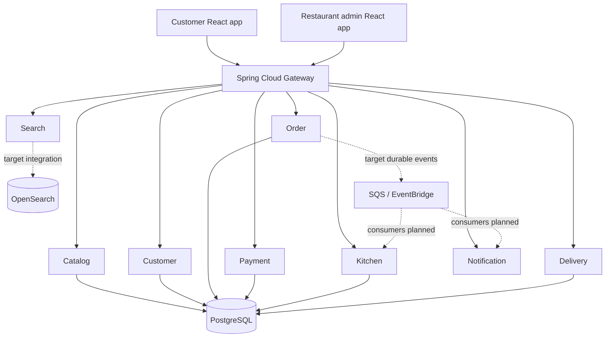

# WordPress publishing details

**Post title:** Building a Food Delivery Platform with Java Microservices, Docker, Kubernetes and AWS  
**SEO title:** Building a Food Delivery Platform with Java Microservices & AWS  
**Slug:** `building-food-delivery-platform-java-microservices-aws`  
**Excerpt:** Explore a Java 21 and Spring Boot food delivery platform for Pada Pav, covering microservices, React, PostgreSQL, Docker, Kubernetes, OpenSearch and AWS. Includes an honest implementation audit and roadmap.  
**Suggested category:** Java & Microservices  
**Suggested tags:** Java 21, Spring Boot, Microservices, Food Delivery App, Docker, Kubernetes, OpenSearch, AWS, Amazon EKS, PostgreSQL, React, Terraform, DevOps  
**Featured image:** Use a 16:9 technical hero image combining the restaurant menu (Pada Pav, Pav Bhaji, Sandwiches, Momos and Mumbai Chaap) with a subtle cloud/microservices motif. Keep text inside the central safe area to avoid theme cropping.

---

# Building a Food Delivery Platform with Java Microservices, Docker, Kubernetes and AWS

*A practical portfolio project: designing Pada Pav's ordering, kitchen, payment, delivery and search platform using Spring Boot, React, OpenSearch and AWS.*

## Introduction

A restaurant food-ordering application looks simple from the customer's point of view: browse the menu, add items to a cart, place an order and receive the food. Behind that experience are several engineering problems: menu availability, price calculation, payment confirmation, kitchen preparation, delivery assignment, customer notifications, search, deployment and monitoring.

I started the **Pada Pav Food Delivery Platform** as a practical engineering project around a restaurant menu that includes Pada Pav, Pav Bhaji, Sandwiches, Momos and Mumbai Chaap. The goal is to use a real business workflow to explore Java microservices, Docker, Kubernetes, OpenSearch and AWS.

This repository is a learning-oriented starter implementation. It contains nine Spring Boot service modules, two React prototypes, Docker Compose configuration, a small Kubernetes/Helm starter, Terraform infrastructure and project documentation. Some integrations are still roadmap items; this article distinguishes the code that exists from the target production architecture.

## 1. Technology stack

| Layer | Technology | Purpose |
|---|---|---|
| Frontend | React, TypeScript, Vite | Customer menu and restaurant admin prototypes |
| Backend | Java 21, Spring Boot | Business services and REST APIs |
| Gateway | Spring Cloud Gateway | API routing |
| Database | PostgreSQL | Transactional menu, customer, order and payment data |
| Cache | Redis | Planned cache/cart integration |
| Search | OpenSearch | Planned menu search and filtering |
| Messaging | Amazon SQS, SNS, EventBridge | Planned asynchronous order events and notifications |
| Containers | Docker, Docker Compose | Local packaging and runtime |
| Orchestration | Kubernetes, Helm, Amazon EKS | Container deployment and scaling |
| Cloud | AWS, Terraform | Infrastructure provisioning |
| CI | GitHub Actions | Maven and frontend build checks |

## 2. Microservice breakdown

The repository separates the main business capabilities into these services:

### Catalog Service
Owns menu item information such as name, category, description, price and availability. Example menu categories include Pada Pav, Pav Bhaji, Sandwiches, Momos and Mumbai Chaap. The catalog service is the source of truth for menu data and pricing.

### Customer Service
Manages customer profile information and delivery addresses. Authentication should be delegated to an identity provider such as Amazon Cognito rather than storing passwords in application tables. Cognito integration is part of the planned security work.

### Order Service
Creates orders, stores order items and manages order status transitions. The backend must recalculate prices from the catalog; it should never trust totals submitted by the browser. The current starter has basic order persistence and state-transition validation, while robust price validation, idempotency and durable event publication remain to be completed.

### Payment Service
Tracks payment attempts and payment status. The current implementation is a demo simulation; it does not connect to a real payment provider. A production version must verify signed webhooks, use idempotency keys and support refund/reconciliation workflows.

### Kitchen Service
Receives restaurant work and tracks preparation states such as ACCEPTED, PREPARING and READY. The intended admin screen will let restaurant staff view and update live orders.

### Delivery Service
Tracks rider assignment, pickup and delivery states. The current assignment flow is a demo; real dispatch, rider identity and location tracking are future work.

### Search Service
Provides menu search. OpenSearch is included in local infrastructure and Terraform, but the current Java search service still returns a hard-coded sample result. The next implementation step is to add OpenSearch mappings, indexing and query logic.

### Notification Service
Exposes notification endpoints and currently stores messages in memory. Real email/SMS provider integration and durable message consumption have not yet been implemented.

### API Gateway
Routes customer/admin requests to backend services. The current gateway configuration is permissive for local learning; authentication, JWT validation, role-based authorization and rate limits must be completed before any public deployment.

## 3. High-level architecture



The solid paths represent the main service and persistence structure. Dotted connections are target integrations, not completed application wiring.

## 4. Order lifecycle

```text
Customer places order
        ↓
Order created / payment pending
        ↓
Payment is confirmed (or COD is accepted)
        ↓
Restaurant accepts order
        ↓
Preparing → Ready
        ↓
Delivery assigned
        ↓
Picked up → Out for delivery → Delivered
```

State transitions should be validated by the backend. Payment confirmation must come from a verified provider result or an explicitly modeled COD workflow—not from a customer request that simply changes the status field.

## 5. Docker and local development

Each Java service has a Dockerfile. The root Docker Compose file describes the services and local dependencies such as PostgreSQL, Redis and OpenSearch. Java JARs must be packaged before the service images are built.

```bash
mvn -B -DskipTests package
docker compose up --build -d
docker compose ps
curl http://localhost:8080/actuator/health
```

The React apps can be started in separate terminals with `npm install` followed by `npm run dev` in `apps/customer-web` or `apps/restaurant-admin`. The current screens are static prototypes and are not yet connected to backend APIs.

## 6. Kubernetes and Helm

The project contains a basic Kubernetes Deployment and Service for the API gateway and a starter Helm chart. A complete deployment must add manifests or Helm releases for every service, readiness and liveness probes, CPU/memory requests and limits, ConfigMaps/Secrets, ingress, HPA, PodDisruptionBudgets, service accounts and network policies.

## 7. AWS architecture

The Terraform starter currently declares a VPC, subnets, EKS cluster and managed node group, RDS PostgreSQL, an S3 media bucket, an OpenSearch domain, SQS, SNS and a CloudWatch log group. The RDS configuration in this repository package has been changed to private access with VPC-scoped ingress, and the database password no longer has a committed default.

Important AWS components still to integrate include ECR for container images, Cognito for customer/admin identity, ElastiCache for Redis, EventBridge for event routing, Secrets Manager and workload IAM, and CloudFront/Route 53/ACM for public frontend hosting and HTTPS. The Terraform configuration has not yet been validated with `terraform plan` or deployed to an AWS account.

## 8. Important engineering lessons

- Keep each service responsible for its own business data and schema. The local starter currently shares one PostgreSQL database for simplicity; production should isolate service schemas and credentials.
- Use OpenSearch as a derived search index, not the source of truth for prices or orders.
- Redis should solve a measured caching or session problem; adding a Redis container alone does not create a cache integration.
- Spring application events are local to one process. Cross-service messaging requires a durable transport such as SQS/EventBridge and normally an outbox pattern.
- Payment, order and notification operations must be idempotent and observable.
- A gateway that permits every request is suitable only for an isolated local demo, never a public environment.
- Kubernetes deployment manifests, a Terraform resource and a Dockerfile are not proof that the complete cloud application has been tested.

## 9. Current implementation status

The repository contains substantial starter code, but key integrations remain incomplete: React-to-API wiring, Cognito/JWT security, real payment provider integration, OpenSearch-backed search, Redis client usage, SQS/EventBridge producer/consumer wiring, durable notifications, full Kubernetes deployment resources and production AWS controls. A full build, runtime test and AWS plan have not yet been verified.

See [the implementation status report](https://github.com/vicky123444/pada-pav-food-delivery-platform/blob/main/docs/implementation-status.md).

## 10. Next steps

1. Secure gateway and service-level authorization.
2. Connect the React apps to catalog, order and kitchen APIs.
3. Add server-side price validation and a payment-provider sandbox.
4. Implement outbox-based order events with SQS/EventBridge.
5. Integrate OpenSearch and Redis in application code.
6. Add all service deployments to Helm/Kubernetes and complete the AWS deployment pipeline.
7. Add integration, contract, browser and load tests.

## Source code

GitHub repository: [https://github.com/vicky123444/pada-pav-food-delivery-platform](https://github.com/vicky123444/pada-pav-food-delivery-platform)

## Conclusion

Pada Pav Food Delivery Platform is a practical way to learn distributed application design around a real restaurant workflow. It brings together Java microservices, frontend development, persistence, messaging, search, Docker, Kubernetes and AWS. The most valuable next step is not adding more infrastructure services; it is making one complete customer-to-kitchen-to-delivery order flow reliable, secure and testable.
